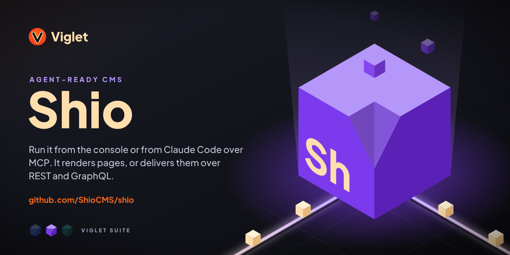
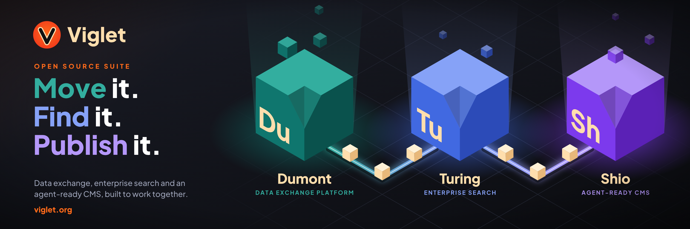

# Viglet Shio: the open source, agent-ready CMS



[](https://shio.viglet.org/)
[](https://docs.viglet.org/shio/)
[](https://www.npmjs.com/package/@viglet/shio)
[](LICENSE)
[](https://github.com/openviglet/shio/commits)
[](https://sonarcloud.io/project/overview?id=viglet_shio)

**Viglet Shio** is an **open source, agent-ready CMS** (content management system).
A person can run all of it from the console, or hand it to an AI coding agent such as
[Claude Code](https://claude.com/claude-code), which builds and maintains the site
through **MCP tools, content as files and blueprints**; the **curator approves** in
a React console with a Universal Editor and preview links; and a **Content
Delivery API** (REST + GraphQL, with TypeScript SDKs) delivers the content to
Next.js, Astro, React, Vue, Svelte or any front end you like.

Shio hosts **no model and no prompts**. It is the substrate an external agent
drives, so the differentiator is protocol quality (discoverability, determinism,
verifiability, token economy), not intelligence.

> 🌐 **Product site:** [shio.viglet.org](https://shio.viglet.org/) ·
> 📚 **Documentation:** [docs.viglet.org/shio](https://docs.viglet.org/shio/) ·
> 🏛 **Viglet open source:** [viglet.org](https://www.viglet.org) ·
> 🔎 **Search & personalization:** [turing.viglet.org](https://turing.viglet.org)

Shio (pronounced [strong /ʃiː/ · weak /ʃɪ/ o]).

---

## Table of contents

- [What is Shio?](#what-is-shio)
- [Why an agent-native CMS?](#why-an-agent-native-cms)
- [Quick start](#quick-start)
- [Using Shio with Claude Code (MCP)](#using-shio-with-claude-code-mcp)
- [Build a front end in JavaScript, with zero Java](#build-a-front-end-in-javascript-with-zero-java)
- [Replicate an existing website](#replicate-an-existing-website)
- [Packages](#packages)
- [The ten design laws](#the-ten-design-laws)
- [Architecture](#architecture)
- [Build from source](#build-from-source)
- [FAQ](#faq)
- [Part of the Viglet suite](#part-of-the-viglet-suite)
- [Contributing](#contributing)
- [License](#license)

---

## What is Shio?

Shio is a **Java + Spring Boot CMS** with a **React** administration
console and a **TypeScript** delivery layer. It models content the way a CMS
always has (sites, folders, posts, post-types, widgets) and then exposes every
one of those capabilities on a surface an agent can actually drive:

| Surface | What it is |
|---|---|
| **MCP server** (`POST /mcp`) | 12 Model Context Protocol tools: `shio_context`, `shio_find`, `shio_read`, `shio_write`, `shio_apply`, `shio_publish`, `shio_assets`, `shio_changes`, `shio_verify`, `shio_digest`, `shio_remember`, `shio_marketplace` |
| **Agent gateway** (`/api/v2/agent/**`) | A manifest, a context pack, planned batches, teaching errors, a review queue, a diagnostics endpoint, and which fields a curator could edit |
| **Content as files** (`shio/content/**`) | The whole site projected to front-mattered Markdown on disk, with a three-way merge back, so `Edit`, `Write` and `Grep` are all an agent needs to author |
| **CLI** (`@viglet/shio`) | 48 verbs: `pull`, `push`, `apply`, `publish`, `find`, `verify`, `preview`, `clone`, `convert`, `types`, `dev`, `deploy`, `patterns`, `status`, `index`, `redirects`, `export`, … |
| **Content Delivery API** (`/api/v2/cda/**`) | Stable REST + GraphQL reads, token-scoped, with zero-dependency TypeScript SDKs, plus two narrow writes: the Universal Editor's save-back, and form submissions landing as drafts |
| **React console** | The curator's half: content browser, 15 form widgets, Universal Editor, review queue, preview links |

Keywords, so you can find this again: *agent-ready CMS, headless CMS, agent-native CMS, AI CMS,
MCP server, Model Context Protocol, Claude Code, content management system, Java
CMS, Spring Boot CMS, Next.js CMS, React CMS, GraphQL CMS, content as code,
GitOps CMS, open source CMS, self-hosted CMS.*

## Why an agent-native CMS?

Every mainstream headless CMS was designed for a person clicking through a web
UI, and then had an API bolted on. When an agent drives one of those, it burns a
whole session discovering what exists, guesses at IDs, gets a `400 Bad Request`
with no instruction in it, and cannot prove its work without asking someone to look at
a screen.

Shio inverts the order. **Every capability lands MCP → files/CLI → REST →
console**: a console-only feature is considered incomplete. Discovery is one
call. Errors carry `fix`, `allowed`, `didYouMean` and `example`. Response sizes
are a *measured budget* asserted in CI, so a token regression fails the build
like any other test. And the curator is never surprised: writes are draft by
default, publishing is explicit, and every agent change lands in a review queue
with attribution.

Read the full concept:
[shio.viglet.org](https://shio.viglet.org/) ·
[docs/specs/SH74-agent-native-cms.md](docs/specs/SH74-agent-native-cms.md) ·
[the comparison against Contentful, Sanity, Strapi and WordPress](https://shio.viglet.org/compare/).

## Quick start

### Run with Docker

```bash
docker run -p 2710:2710 -e SHIO_ADMIN_PASSWORD=shio123 ghcr.io/openviglet/shio-ce:latest
```

`SHIO_ADMIN_PASSWORD` (minimum 6 characters) is applied on the **first** start and gives you a
usable `admin` login straight away, which is what makes the container scriptable, since every
API surface answers 401 until a password exists. Leave it out and the console asks you to set
one on first access instead. It is **never** applied over a password that is already
configured, so it is safe to leave in a compose file: a restart is a no-op.

### Or run from source

```bash
git clone https://github.com/openviglet/shio.git
cd shio
./mvnw spring-boot:run -pl shio-app
```

Then open:

- **Console**: <http://localhost:2710> (log in as `admin`; the password is the one
  `SHIO_ADMIN_PASSWORD` set, or the one the first-access screen asks you for)
- **Sample site**: <http://localhost:2710/sites/viglet/default/en-us>

Requirements: **Java 21**, **Node ≥ 26** and **pnpm ≥ 11** (only if you build the
console yourself; pass `-Dskip.npm=true` to skip it).

## Using Shio with Claude Code (MCP)

Shio ships a **[Claude Code](https://claude.com/claude-code) plugin** and an
**MCP (Model Context Protocol) server**, so an agent session starts already
knowing your CMS instead of spending its first ten calls discovering it.

```bash
claude plugin marketplace add openviglet/shio
claude plugin install shio
```

Point it at your instance:

```bash
export SHIO_URL=http://localhost:2710
export SHIO_USER=admin
export SHIO_PASSWORD=...
```

No plugin? The CLI is an stdio MCP bridge on its own:

```bash
claude mcp add shio -- npx -y @viglet/shio mcp
```

The plugin also adds **skills** (`shio-site`, `shio-content-model`,
`shio-verify`) that load only when the work calls for them. Details:
[claude-plugin/README.md](claude-plugin/README.md) ·
[shio.viglet.org/claude-code](https://shio.viglet.org/claude-code/).

## Build a front end in JavaScript, with zero Java

```bash
npm create @viglet/shio-app@latest my-site
cd my-site && npm run dev
```

That scaffolds a **Next.js (App Router)** site wired to the Content Delivery
API. From there:

```bash
npx @viglet/shio pull      # content + post-types onto disk, as files
npx @viglet/shio types     # generate a .d.ts so post.attrs.* autocompletes
npx @viglet/shio push      # apply your local content model back to Shio
npx @viglet/shio publish   # explicit, never implicit
```

## Replicate an existing website

`shio clone` captures a live site, `propose` derives a content model from its
markup, and `convert` turns it into real Shio posts: fidelity mode for a
pixel-accurate copy, authorable mode for one a curator can edit. The choice is
per block, so most pages end up **mixed**: the blocks you accepted become
sections, and each run of kept markup becomes a section too, movable and
replaceable, rather than a field the editor cannot reach. An authorable page is
redrawn with Shio's own vocabulary, and the theme it is presented with takes its
**colours, type and corner radius from the source**, matched by the role the
source's stylesheet uses each one in, with everything it could not fill named in
the run.

There is a third choice. `convert --annotate` stamps the field mapping onto a
wholly verbatim page's **own markup**, so the page keeps the source's bytes
(strip the attributes back out and they are identical) and a curator can still
edit its heading in place. Pixel-perfect and authorable is not a contradiction:
attributes do not lay out.

Then `judge` says whether the round is **done**. It runs the instruments, answers
once, and holds the answer to a declared bar: a finding at or below it prints as
a task for later, one above it fails. The bar's own point is what it leaves
*out*: **looking like the source is not a test an authorable replica has to
pass**. It is presented by Shio's theme on purpose, so it is held to its content,
its structure and its routes, and `--fidelity` is how you ask for the pixel
comparison instead.

```bash
npx @viglet/shio clone https://example.com --max-pages 50 --render --assets
npx @viglet/shio propose --accept all
npx @viglet/shio convert
npx @viglet/shio publish --all   # drafts until you say so
npx @viglet/shio judge           # ACCEPTED, or what holds it
```

See [shio.viglet.org/replicate](https://shio.viglet.org/replicate/).

## Packages

All published to **[npm](https://www.npmjs.com/org/viglet)** under the
`@viglet` scope, all Apache-2.0:

| Package | What it does |
|---|---|
| [`@viglet/shio`](https://www.npmjs.com/package/@viglet/shio) | The Shio **CLI**: content as files, post-types as code, site replication, and the stdio **MCP bridge** ([source](cli/)) |
| [`@viglet/shio-client`](https://www.npmjs.com/package/@viglet/shio-client) | Framework-agnostic **TypeScript client** for the Content Delivery API. Zero dependencies ([source](shio-client/)) |
| [`@viglet/shio-react-sdk`](https://www.npmjs.com/package/@viglet/shio-react-sdk) | **React SDK**: hooks and render components on top of the client ([source](shio-react-sdk/)) |
| [`@viglet/shio-model`](https://www.npmjs.com/package/@viglet/shio-model) | Typed **DSL** for authoring the content model as code ([source](shio-model/)) |
| [`@viglet/shio-sections`](https://www.npmjs.com/package/@viglet/shio-sections) | The **page-section vocabulary**: section post-types plus matching React components ([source](shio-sections/)) |
| [`@viglet/shio-editor-cors`](https://www.npmjs.com/package/@viglet/shio-editor-cors) | The **Universal Editor bridge**: inline visual editing for any front end ([source](shio-js-sdk/)) |
| [`@viglet/create-shio-app`](https://www.npmjs.com/package/@viglet/create-shio-app) | **Next.js starter generator** ([source](create-shio-app/)) |

The Java backend ships as a **Docker image**,
[`ghcr.io/openviglet/shio-ce`](https://github.com/openviglet/shio/pkgs/container/shio-ce),
and as an executable Spring Boot jar built from [shio-app/](shio-app/).

## The ten design laws

A feature that violates one of these is wrong even if it was requested.

| # | Law |
|---|---|
| **P1** | **Agent-first design order**: every capability lands MCP → files/CLI → REST → console |
| **P2** | **One call replaces a session**: discovery is a product feature, not a docs problem |
| **P3** | **Tokens are a measured budget**: a token regression is a build failure |
| **P4** | **Files beat APIs for authoring**: `Edit`, `Write` and `Grep` are the cheapest tools an agent has |
| **P5** | **Determinism over cleverness**: stable ordering, path addressing, idempotent writes |
| **P6** | **Errors are instructions**: every 4xx carries `fix`, `allowed`, `didYouMean`, `example` |
| **P7** | **Never surprise the curator**: draft-default, dry-run, explicit publish, review queue |
| **P8** | **Skipping steps needs appliable units**: blueprints, not prose recipes |
| **P9** | **Close the perception loop**: cheap textual proof instead of asking someone to look |
| **P10** | **Compose, don't fork**: MCP is a *shape* over the delivery API, never a third contract |

Full text and rationale: [agents.md](agents.md).

## Architecture

```
shio-app/          Spring Boot 4 + Java 21 backend: content engine, CDA, agent gateway, MCP server
shio-react/        React 19 + Vite + shadcn/ui administration console
shio-client/       @viglet/shio-client      zero-dependency CDA client (TypeScript)
shio-react-sdk/    @viglet/shio-react-sdk   React hooks and components
shio-model/        @viglet/shio-model       content-model DSL
shio-sections/     @viglet/shio-sections    page-section vocabulary
shio-js-sdk/       @viglet/shio-editor-cors Universal Editor bridge
create-shio-app/   @viglet/create-shio-app  Next.js starter generator
cli/               @viglet/shio             the CLI and the MCP stdio bridge
claude-plugin/     The Shio plugin for Claude Code
shio-site/         The public site at shio.viglet.org
shio-examples/     Example sites (corporate, blog)
docs/              Roadmap, changelog, specs and the per-area agent guides
```

Backend on `http://localhost:2710`, React dev server on `5173`, API prefix
`/api/v2/`. Databases: **H2** out of the box, **PostgreSQL** and **MariaDB**
supported, schema owned by **Liquibase**.

## Build from source

```bash
./mvnw -pl shio-app -am clean test -Dskip.npm=true   # backend
pnpm install && pnpm test                            # JavaScript workspace
```

Per-area guides live in [docs/agents/](docs/agents/):
[renderer](docs/agents/renderer.md),
[agent surface](docs/agents/agent-surface.md),
[MCP](docs/agents/mcp.md),
[content API](docs/agents/content-api.md),
[content as files](docs/agents/content-files.md),
[console UI](docs/agents/console-ui.md),
[database](docs/agents/database.md),
[build](docs/agents/build.md).

## FAQ

**Is Viglet Shio free and open source?**
Yes. Apache License 2.0, self-hosted, no paid tier required. See [LICENSE](LICENSE).

**Is it a headless CMS?**
Yes. Content is delivered over a REST and GraphQL Content Delivery API with token
scopes: reads by default, and the only writes it accepts are narrow and scoped
(the visual editor's save-back, and form submissions that land as drafts). There
are TypeScript SDKs for it. Shio also *renders*
pages itself if you want it to (layouts, regions, themes and a section
vocabulary), so headless is a choice, not a constraint.

**What is an "agent-native" CMS?**
One where the AI coding agent is a first-class operator, not an API consumer
retrofitted onto a click-driven product: MCP tools, one-call discovery,
content projected to files, teaching errors, measured token budgets and
verifiable output.

**Does it work with Claude Code?**
Yes. There is a first-party [Claude Code](https://claude.com/claude-code)
plugin and an MCP server. See
[shio.viglet.org/claude-code](https://shio.viglet.org/claude-code/).

**Does Shio call an LLM?**
No. Shio hosts no model and no prompts. It is the substrate an external agent
drives, which is why it works with any MCP-capable agent.

**Which front-end frameworks are supported?**
Any. `@viglet/shio-client` is framework-agnostic and dependency-free (Node, the
browser, edge runtimes, Next.js server components, Astro, Vue, Svelte), and
`@viglet/shio-react-sdk` adds React hooks and components on top.

**Can it replicate an existing website?**
Yes: `shio clone` / `propose` / `convert` / `publish` / `judge`, and `judge` is
the one that tells you when to stop. See
[shio.viglet.org/replicate](https://shio.viglet.org/replicate/).

## Part of the Viglet suite



Three open source products that work together, or each on its own:

| Product | What it does |
|---|---|
| [**Viglet Dumont**](https://github.com/openviglet/dumont) · Data Exchange Platform | Connects your sources (AEM, WordPress, databases, files, web) and delivers their content to Turing or any other search engine |
| [**Viglet Turing**](https://github.com/openviglet/turing) · Enterprise Search | Search, semantic navigation, RAG chat with citations and AI agents over your content, self-hosted |
| **Viglet Shio** · Agent-ready CMS | This repository: the CMS that people run from the console and AI agents run over MCP |

More at [viglet.org](https://www.viglet.org).

## Contributing

We use [GitHub issues](https://github.com/openviglet/shio/issues) for requests
and bugs. Please review the
[contribution guidelines](CONTRIBUTING.md), the
[code of conduct](CODE_OF_CONDUCT.md) and the
[security policy](SECURITY.md) first.

## License

[Apache License 2.0](LICENSE). Copyright © 2016–2026 the Viglet Team.

---

Built by the [Viglet](https://www.viglet.org) Team ·
**[shio.viglet.org](https://shio.viglet.org/)**
